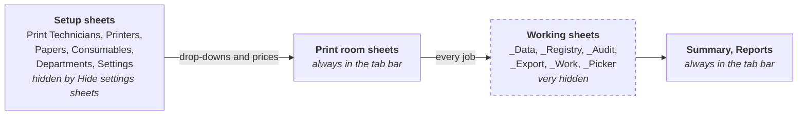

# Protection and hidden sheets

How the workbook guards against accidental changes, and which sheets are out
of sight.

## The sheets at a glance

## Protected sheets

Every sheet is protected without a password. You can type in the cells meant
for input, such as a job's details or a printer's price. Other cells are
locked:

- calculated columns, such as Unit, the costs and Status
- IDs, such as TechID and Job ID
- the read-only rows on Settings
- a print room's name, once set (use **Rename print room...**)

Protection is there to stop slips, not to keep anyone out. The workbook
protects every sheet again each time it opens.

## Hide the setup sheets

On **Summary**, click **Hide settings sheets**. The Print Technicians,
Printers, Papers, Consumables, Departments and Settings tabs disappear. Click
**Show settings sheets** to bring them back.

This only tidies the tab bar. Anyone can still show the sheets with Excel's
**Unhide**.

## Working sheets you never see

Six sheets are hidden so they do not appear in **Unhide** either:

| Sheet | Holds |
| --- | --- |
| `_Data` | Every room's jobs in one list, which Summary and Reports read |
| `_Registry` | The list of print rooms, their codes and export status |
| `_Audit` | A log of removals, restores and other big changes |
| `_Export`, `_Work`, `_Picker` | Scratch space for exports and the printer picker |

Do not try to change these. The workbook rebuilds what it needs.

## Things to know

- Adding your own password to a sheet is not supported. The buttons need to
  unprotect sheets to write to them.
- Sorting and filtering are turned off on print room sheets, to keep colour
  passes with their jobs. Use [Reports](Reports-Filtering).

## Platform notes

> **Mac:** not yet checked.
>
> **Windows:** not yet checked.

## Related pages

- [How it works](How-It-Works)
- [Settings](Setup-Settings)

---

*Draft for v0.11.4, without screenshots yet. Not yet verified on Windows.*
