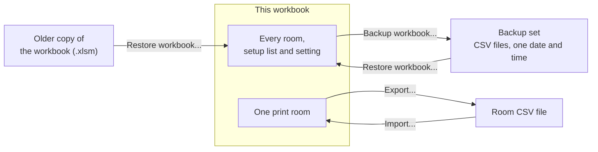

# Backup and restore

Save everything in the workbook in one go, and bring it back later or into
a new workbook.

## How the files fit together

Exports and imports move one room's jobs. A backup and a restore move
everything. See [Exporting a print room](Data-Export-Room) and
[Importing jobs](Data-Import).

## Back up the workbook

1. On **Settings**, click **Backup workbook...**.
2. A message says where the files were written.

## Result

A set of CSV files sharing one date and time in their names: one per print
room, one per setup list (technicians, printers, papers, departments and the
Settings lists) and one for the settings. A backup always includes student
names.

## Restore from a backup

1. On **Settings**, click **Restore workbook...**.
2. Choose any one file from the backup. The workbook finds the rest of the
   set by its date and time.
3. Read the summary of what will change and click **Yes**.

## Restore from an older copy of the workbook

The same command can read another copy of the workbook (`.xlsm`) instead of a
backup. This is how you upgrade; see [Upgrading](Admin-Upgrading).

## What a restore does

- **Setup lists**: rows from the backup replace rows with the same ID, and
  new ones are added. A row from another site whose name is already taken is
  added with the site after its name, such as `HP T730 (SITE2)`.
- **Settings**: values come across, except the read-only rows (version,
  build and ID counters).
- **Print rooms**: a room the workbook does not have is created, with its
  defaults, printers and roll length unit. Jobs are added or replaced by Job
  ID, as an import does.
- **The sample room** is removed once your own rooms are in, if nobody has
  changed it.

Running the same restore twice creates no second rooms and no duplicate
jobs. The backup files or older workbook are never changed.

> **Warning:** a restore replaces setup rows and jobs that share an ID with
> the backup. It cannot be undone. Back up the current workbook first if you
> may want it back.

## Platform notes

> **Mac:** when restoring from an older workbook, Excel may ask about that
> workbook's macros. Choose **Disable Macros**: the workbook shows
> a notice first saying they are not needed for the restore. The file picker may also look different from usual.
>
> **Windows:** not yet checked.

## Related pages

- [Exporting a print room](Data-Export-Room)
- [Importing jobs](Data-Import)
- [Upgrading](Admin-Upgrading)

---

*Draft for v0.11.4, without screenshots yet. Not yet verified on Windows.*
