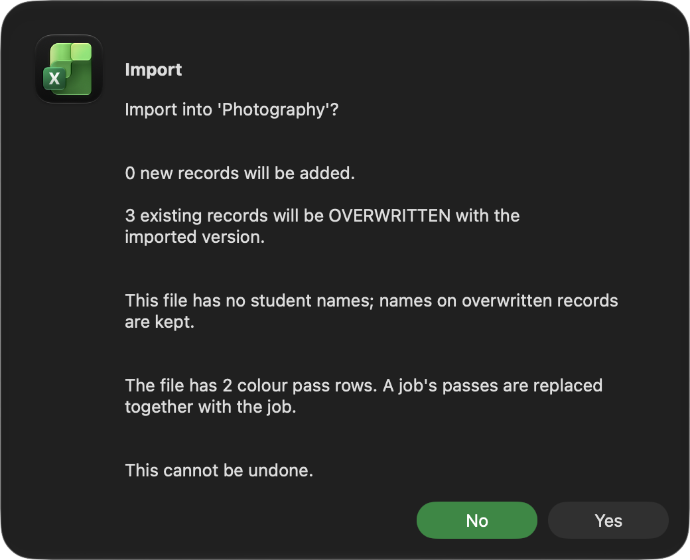

# Importing jobs

Bring jobs from an exported CSV file into a print room.

## Before you start

- You need a file made by **Export...** or **Export All Locations...**. See
  [Exporting a print room](Data-Export-Room).

## Import into the room you are on

1. Open the print room's sheet.
2. Click **Import...** on the right of the sheet.
3. Choose the CSV file. The picker does not open where the file is: go to
   the folder the export message named.
4. Read how many jobs will be added and how many will replace jobs already
   there, then click **Yes**.

## Import into a room you choose

1. On **Settings**, click **Import (choose room)...**.
2. Choose the CSV file.
3. Type the code of the room to import into, from the list shown.
4. Check the counts and click **Yes**.

## Result

- A job whose Job ID is not in the room is added.
- A job whose Job ID is already there is replaced by the file's version.
  This is how importing an older export puts jobs back as they were.
- The room is checked afterwards, so **Status** is filled in on every job.

Importing the same file twice changes nothing the second time.

## Things to know

- Imported jobs keep the prices they were costed at, whatever this
  workbook's price lists say now.
- Importing never changes the setup sheets. A technician, printer or paper
  that is not in this workbook's lists is kept as text on the job.
- A file exported without names leaves the names already on matching jobs
  alone, and adds new jobs with a blank name.
- Colour passes come with their job and replace its old passes as a whole.

> **Warning:** an import that replaces jobs cannot be undone. Export the room
> first if you may want its current jobs back.

## Platform notes

> **Mac:** the file picker may look different from usual, as the workbook
> tries more than one way to open it. To reach a folder you cannot click to,
> such as one inside your Library folder, press Shift+Cmd+G and type or
> paste its path.
>
> **Windows:** not yet checked.

## Related pages

- [Exporting a print room](Data-Export-Room)
- [Backup and restore](Data-Backup-and-Restore)

---

*Draft for v0.11.5, with Mac screenshots. Not yet verified on Windows.*
