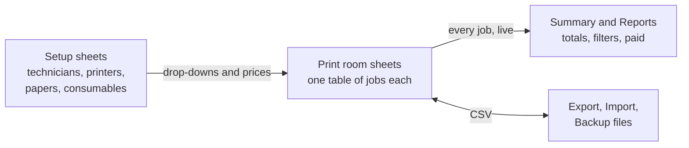

# How it works

The ideas behind the workbook, so the rest of the pages make sense.

## One workbook, many print rooms

A workbook is one site, such as a bureau or a campus. Inside it, each print
room has its own sheet with a table of print jobs. The **Summary** and
**Reports** sheets read the jobs from every room at once.

The setup sheets (**Print Technicians**, **Printers**, **Papers**,
**Consumables**, **Departments** and **Settings**) hold the lists that a job is
chosen and priced from.

## A print job

Each row on a print room sheet is one job: when it was printed, who it was
for, the technician, the printer, the paper and how much. The workbook works
out the printed area and the costs from those entries.

Every job gets a **Job ID**, made of the site, the room's code and a number,
such as `UNI-MAIN-00042`. A number is never reused, even after its job is
deleted.

## Prices are frozen when a job is recorded

When you record a job, the workbook copies the current paper and consumable
prices onto the row. Later price changes do not alter jobs already recorded,
so a student is charged what the job cost on the day. The same goes for
renaming a printer or making a paper inactive.

If a price was entered wrongly, **Re-stamp prices...** on Settings applies
today's prices to every job in every room. It cannot be undone. See
[Settings](Setup-Settings).

## Gross, disregarded and chargeable

Each job shows three costs:

- **Gross Cost**: paper, consumable and any set-up cost.
- **Disregarded**: the part that is not charged. Setting **Disregard Paper**
  or **Disregard Consumable** to Yes moves that part here, for example when a
  student brings their own paper.
- **Chargeable Cost**: what is left to pay.

The paper and ink are still counted as used either way, so usage figures stay
true.

## Checking, not blocking

Drop-downs only offer technicians, printers and papers that are active and fit
together. Beyond that, the workbook warns rather than refuses. A job with a
problem says so in its **Status** column, and the problem is listed in a note
on that cell. See [Validation and status](Jobs-Validation-and-Status).

## Reports are always up to date

**Summary** and **Reports** are worksheet formulas over every room's jobs.
They update as soon as a job changes, with nothing to refresh. The one
exception is a print room added by hand rather than with **Add print
room...**: click **Refresh Locations** so the reports include it.

## Things to know

- Multi-pass printers, such as a Risograph, cost each colour pass separately.
  See [Colour passes](Jobs-Colour-Passes).
- Moving jobs between workbooks, and upgrading, use exported files. See
  [Exporting a print room](Data-Export-Room) and
  [Upgrading](Admin-Upgrading).

## Platform notes

> The ideas on this page are the same on Windows and Mac.

## Related pages

- [Getting started](Getting-Started)
- [Glossary](Glossary)

---

*Draft for v0.11.4, without screenshots yet. Not yet verified on Windows.*
