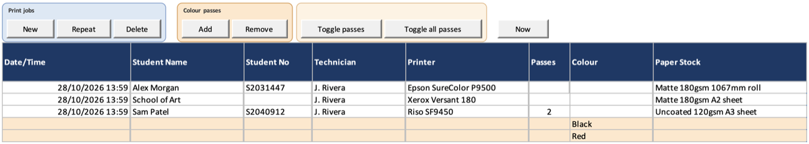

# Colour passes

Record a job on a multi-pass printer, such as a Risograph, with one pass per
colour.

## Before you start

- The printer is set up as multi-pass, with a Template cost. See
  [Printers](Setup-Printers).
- Its colours are listed on [Consumables](Setup-Consumables).

## Record a multi-pass job

1. Record the job as usual with **New**, choosing the multi-pass printer and
   a sheet paper. See [Recording jobs](Jobs-Recording).
2. With a cell in the job selected, click **Add** in the **Colour passes**
   panel. A pass row appears under the job.
3. Choose the pass's **Colour**.
4. Repeat steps 2 and 3 for each colour.

## Result

Each pass costs its colour's ink over the job's whole printed area, plus the
printer's Template cost for setting it up. The job row shows the totals in
**Consumable Cost** and **Set-up Cost**. Status shows "At least one colour
pass is required" until the job has a pass.

## Remove a pass

1. Click a cell in the pass row.
2. Click **Remove** in the **Colour passes** panel and confirm.

The other passes are renumbered.

## Show and hide passes

- **Toggle passes** folds or unfolds the selected job's passes.
- **Toggle all passes** does the same for every job on the sheet.
- **Hide pass columns** hides the Passes, Colour and other pass columns on
  every room. **Show pass columns** brings them back.

## Things to know

- **Add** and **Remove** only work with a multi-pass job or one of its passes
  selected. Otherwise they say so.
- A job with passes cannot change printer. Remove the passes first, or record
  a new job.
- The job's printer, paper, quantity and other details stay on the job row.
  A pass only takes a colour.
- Each pass keeps the prices it was added with. **Repeat** copies a job with
  all its passes, at today's prices.
- **Summary** and **Reports** show each job's number of passes and its
  set-up cost, not the passes one by one.

## Platform notes

> **Mac:** not yet checked.
>
> **Windows:** not yet checked.

## Related pages

- [Printers](Setup-Printers)
- [Consumables](Setup-Consumables)
- [Validation and status](Jobs-Validation-and-Status)

---

*Draft for v0.11.4, with Mac screenshots. Not yet verified on Windows.*
