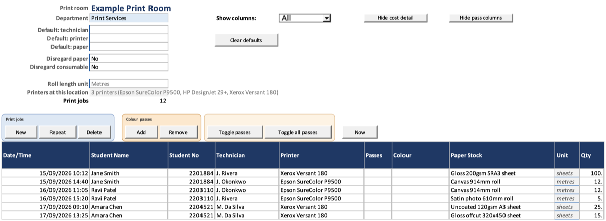
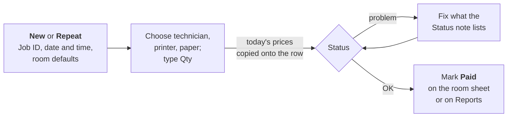

# Recording jobs

Add a print job to a print room sheet, copy one, or delete one.

## Before you start

- The room needs its printers chosen. See [Print rooms](Setup-Print-Rooms).

## Record a job

1. Open the print room's sheet.
2. In the **Print jobs** panel above the table, click **New**. A row is added
   at the bottom with its **Job ID**, today's date and time, and the room's
   defaults filled in.
3. Type the **Student Name**, the **Student No**, or both.
4. Choose the **Technician**, **Printer** and **Paper Stock**, if the defaults
   did not fill them.
5. Type the **Qty**: sheets for sheet paper, or the length for roll paper. The
   **Unit** column says which.
6. For roll paper narrower than the roll, type the **Print Width mm**. Leave
   it blank to cost the full roll width.
7. Add **Notes** if you want to.

## Result

The costs fill in and **Status** shows OK. If Status shows something else,
see [Validation and status](Jobs-Validation-and-Status).

## A job from start to finish

The prices are copied again whenever the technician, printer, paper, print
width or sheet size is changed, so a change to one of those re-prices the job
at today's prices. Other edits, and later price changes, leave it alone.

## Use defaults for a batch

The top of the sheet holds the room's defaults. Every new job starts with
them:

- **Default: technician**, **Default: printer**, **Default: paper**: set
  these when you are about to record several similar jobs. Click **Clear
  defaults** when the batch is done.
- **Disregard paper**, **Disregard consumable**: Yes means new jobs start
  with that part of the cost not charged. **Clear defaults** leaves these
  alone.

Changing a default never changes a job already added.

## Copy a job

1. Click any cell in the job to copy.
2. Click **Repeat**.

The copy gets a new Job ID and the current date and time, and starts unpaid.
The student, printer, paper, quantity, sizes, disregard settings and any colour
passes are copied. The technician comes from the room's default instead, and
**Notes** says which job it was copied from. The copy is priced at today's
prices.

## Delete a job

1. Click any cell in the job.
2. Click **Delete**.
3. Check the details shown and click **Yes**.

> **Warning:** a deleted job cannot be brought back, and its Job ID is never
> reused. Deleting a job also deletes its colour passes.

## Things to know

- To correct the date and time, click a cell in the job and click **Now**,
  or double-click an empty **Date/Time** cell.
- For a department rather than a student, type the department's name in
  **Student Name**. See [Departments](Setup-Departments).
- If a name and number do not match earlier jobs in any room, the workbook
  warns you. It never stops you.
- Print room sheets cannot be sorted or filtered. Use
  [Reports](Reports-Filtering) for that.

## Platform notes

> **Mac:** not yet checked.
>
> **Windows:** not yet checked.

## Related pages

- [Views and units](Jobs-Views-and-Units)
- [Colour passes](Jobs-Colour-Passes)
- [Paid tracking](Jobs-Paid-Tracking)

---

*Draft for v0.11.4, with Mac screenshots. Not yet verified on Windows.*
