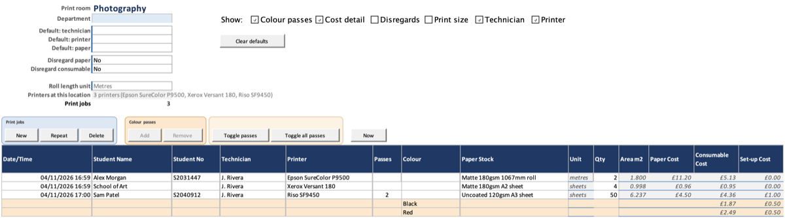

# Views and units

Choose how many columns a print room sheet shows, and whether roll lengths
are typed in metres or centimetres.

## Choose which columns show

On a print room sheet, find **Show:** near the top, and tick or untick:

| Box | Columns |
| --- | --- |
| **Colour passes** | Passes, Colour |
| **Cost detail** | Paper Cost, Consumable Cost, Set-up Cost, Gross Cost, Disregarded, Area m2 |
| **Disregards** | Disregard Paper, Disregard Consumable |
| **Print size** | Print Width mm, Sheet size |
| **Technician** | Technician |
| **Printer** | Printer |

Each room keeps its own choices. Status, Chargeable Cost, Paid and the columns
you fill in for every job always show.

Two boxes start from what the room has:

- **Colour passes** starts ticked if the room has a multi-pass printer or
  already has colour passes.
- **Printer** starts unticked if the room has exactly one printer, because new
  jobs fill it in for you.

Your click stays until the room's printers change that answer.

## Type roll lengths in centimetres

1. At the top of the room's sheet, set **Roll length unit** to Centimetres.
2. Type roll quantities in centimetres. The **Unit** column shows `cm`.

Lengths already entered on that sheet are converted for you, so a 1.5 metre
job now shows 150. Costs do not change. **Summary** and **Reports** always
show roll lengths in metres.

## Things to know

- Roll length unit is set per room. One room cannot mix metres and
  centimetres.
- Hidden columns still hold their values, and still count in costs and
  reports.
- A hidden column comes back by itself when a job needs it: **Add pass** for
  Colour passes, a new job with no technician or printer to fill in, or
  student-supplied paper for Print size.
- Job ID and the other internal columns are controlled by **Show internal
  columns** on [Settings](Setup-Settings), for every room at once.

## Platform notes

> **Mac:** not yet checked.
>
> **Windows:** not yet checked.

## Related pages

- [Recording jobs](Jobs-Recording)
- [Settings](Setup-Settings)

---

*Draft for v0.12.1, with Mac screenshots. Not yet verified on Windows.*
