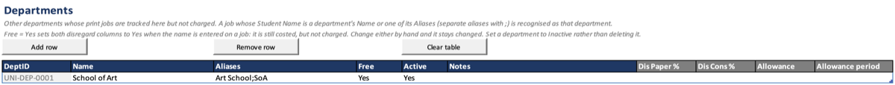

# Departments

List departments whose print jobs you track, and mark the ones that are not
charged.

## Before you start

- Agree the name each department goes by, so staff type it the same way on
  every job.

## Add a department

1. Open the **Departments** sheet and click **Add row**. The new row gets its
   **DeptID**.
2. Type the department's **Name**, such as `School of Art`.
3. Under **Aliases**, type any other names people use for it, separated by
   semicolons: `Art;Fine Art`.
4. Set **Free** to Yes if its jobs are not charged, or No if they are.
5. Leave **Active** as Yes. Add **Notes** if you want to.

## Result

When a job's **Student Name** is the department's name or one of its aliases,
the job counts as that department. Capitals and spaces at either end do not
matter.

- With **Free** set to Yes, the workbook sets both **Disregard Paper** and
  **Disregard Consumable** to Yes as the name is typed. The job is costed but
  its chargeable cost is 0.
- With **Free** set to No, the charge is unchanged. The department is only
  used for grouping.

Either way, the job shows under that department in the **Department** filter
on Reports and in the **By department** blocks on Reports and Summary.

## Things to know

- The disregard is set once, when the name is entered. If you change either
  Disregard column on that job afterwards, your change stays.
- When a department closes or changes name, set **Active** to No and add a
  new row, rather than renaming or removing it. Its old jobs stay grouped
  under the old name.
- Each name or alias should belong to one department only. The workbook warns
  if one is used twice.
- The grey columns at the right (**Dis Paper %**, **Dis Cons %**,
  **Allowance**, **Allowance period**) are for a later version. Nothing reads
  them yet.

## Platform notes

> **Mac:** not yet checked.
>
> **Windows:** not yet checked.

## Related pages

- [Recording jobs](Jobs-Recording)
- [Filtering](Reports-Filtering)
- [Summary](Reports-Summary)

---

*Draft for v0.11.4, with Mac screenshots. Not yet verified on Windows.*
