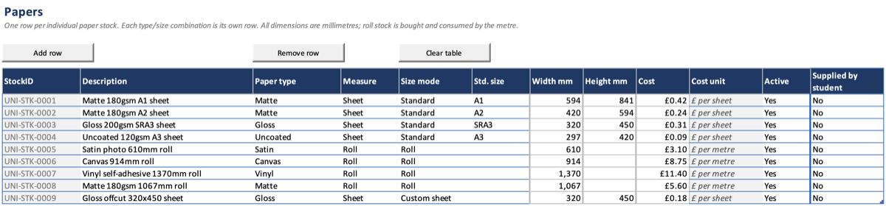

# Papers

List each paper stock you print on, its size and what it costs.

## Before you start

- Check that the paper type (Matte, Gloss, Canvas and so on) is in the
  **Paper stock types** list on Settings, and for standard sheets that the
  size is in **Standard paper sizes**. See [Lookup lists](Setup-Lookup-Lists).

## Add a paper

1. Open the **Papers** sheet and click **Add row**. The new row gets its
   **StockID**.
2. Type a **Description** that tells stocks apart in a drop-down, such as
   `Matte 180gsm A1 sheet`.
3. Choose the **Paper type**.
4. Choose the **Measure**: Sheet for paper counted in sheets, Roll for paper
   counted in metres.
5. Choose the **Size mode** and fill in the size:
   - **Standard**: choose the **Std. size**. Width and height fill in for you.
   - **Custom sheet**: type the **Width mm** and **Height mm**.
   - **Roll**: type the roll's **Width mm** only.
6. Type the **Cost**: per sheet for sheet paper, per metre for roll paper. The
   **Cost unit** column shows which.
7. Leave **Active** as Yes and **Supplied by student** as No.

## Result

The paper appears in the **Paper Stock** drop-down on jobs whose printer it
fits. See [Printers](Setup-Printers) for how fit is worked out.

## Paper the student brings

There are two ways to record it:

- **One-off paper**: choose **Supplied (Roll)** or **Supplied (Sheet)** as the
  job's paper. These two are built in and are not rows on this sheet. The job
  then needs a **Print Width mm** (roll) or a **Sheet size** (sheet), since
  the workbook has no size for the paper.
- **A stock you keep for students**, such as a delivery of their own paper:
  add it as a normal row and set **Supplied by student** to Yes. Its paper
  cost is always 0, but its size still decides which printers it fits.

Either way, the job still pays for ink or toner.

## Things to know

- Each type and size is its own row. Matte A1 and Matte A2 are two papers.
- All sizes are in millimetres.
- When you stop stocking a paper, set **Active** to No rather than removing
  the row. Old jobs keep it.
- Changing a cost does not change jobs already recorded.
- **Supplied (Roll)** and **Supplied (Sheet)** are reserved names. A row on
  this sheet cannot use them.

## Platform notes

> **Mac:** not yet checked.
>
> **Windows:** not yet checked.

## Related pages

- [Printers](Setup-Printers)
- [Lookup lists](Setup-Lookup-Lists)
- [Recording jobs](Jobs-Recording)

---

*Draft for v0.11.5, with Mac screenshots. Not yet verified on Windows.*
