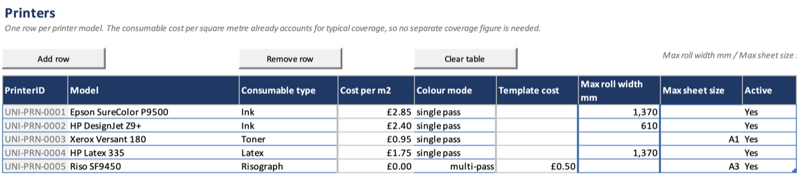
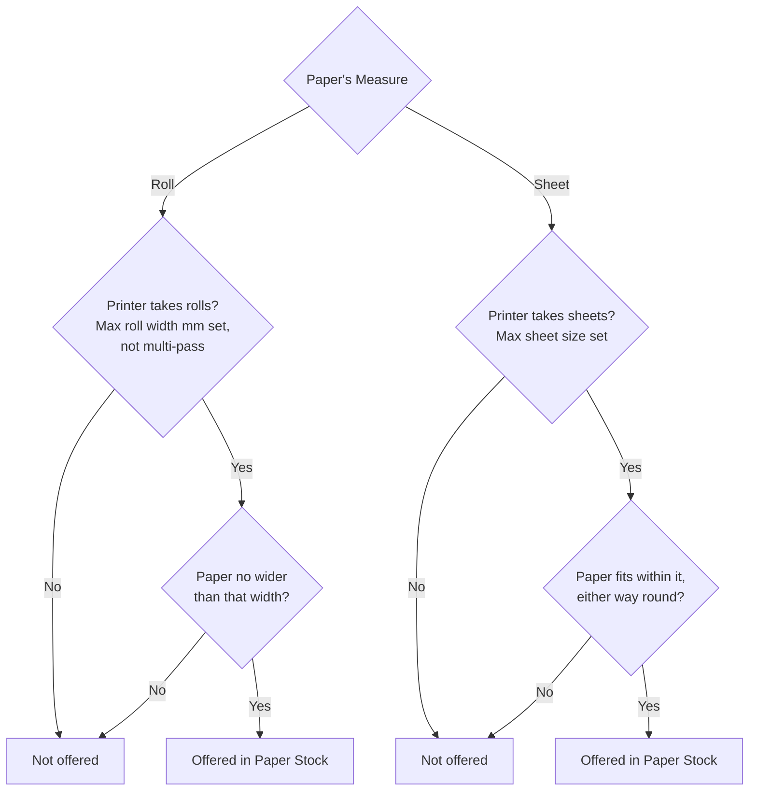

# Printers

List each printer, what its ink or toner costs, and what paper it can take.

## Before you start

- Check that the printer's consumable type (Ink, Toner, Latex and so on) is
  in the **Consumable types** list on Settings. See
  [Lookup lists](Setup-Lookup-Lists).
- For a printer that takes sheets, check that its largest sheet size is in
  the **Standard paper sizes** list on Settings.

## Add a printer

1. Open the **Printers** sheet and click **Add row**. The new row gets its
   **PrinterID**.
2. Type the **Model**, as you want it to appear in drop-downs.
3. Choose the **Consumable type**.
4. Type the **Cost per m2**: what the ink or toner costs for one square metre
   of printing. Use a figure for typical coverage; there is no separate
   coverage setting.
5. Set what the printer can take. Fill in one or both:
   - **Max roll width mm**, for a roll printer: the widest roll it takes.
   - **Max sheet size**, for a sheet printer: the largest standard size it
     prints.
6. Leave **Colour mode** as single pass, unless it is a multi-pass printer
   (below).
7. Leave **Active** as Yes.

## Result

The printer can be added to a print room with **Select printers...**. See
[Print rooms](Setup-Print-Rooms).

## Which paper fits which printer

A paper can be used on a printer only if it fits:

- A roll paper's width must be no more than the printer's **Max roll width
  mm**.
- A sheet paper must fit within the printer's **Max sheet size**, either way
  round.
- A blank capacity means the printer cannot take that kind of paper at all.
- **Supplied (Roll)** and **Supplied (Sheet)** fit any printer that takes
  that kind of paper. The job's **Print Width mm** or **Sheet size** is then
  checked against the printer instead.

The **Paper Stock** drop-down on a job offers only papers that fit the job's
printer.

## Multi-pass printers

A multi-pass printer, such as a Risograph, prints one colour at a time.

1. Set **Colour mode** to multi-pass.
2. Type the **Template cost**: the set-up cost of one colour pass, such as a
   master or stencil.
3. Set a **Max sheet size**. Multi-pass printers take sheet paper only.
4. Add the printer's colours on [Consumables](Setup-Consumables).

Each pass's ink is costed from its colour. The printer's **Cost per m2** is
added on top for the job as a whole, so set it to 0 unless there is a running
cost per job as well.

## Things to know

- When a printer is retired, set **Active** to No rather than removing the
  row. It leaves the drop-downs, and old jobs keep it.
- Changing a price does not change jobs already recorded. See
  [How it works](How-It-Works).
- Changing a capacity does not change jobs already recorded either. It only
  affects which papers new jobs can choose.

## Platform notes

> **Mac:** not yet checked.
>
> **Windows:** not yet checked.

## Related pages

- [Papers](Setup-Papers)
- [Consumables](Setup-Consumables)
- [Colour passes](Jobs-Colour-Passes)

---

*Draft for v0.11.4, with Mac screenshots. Not yet verified on Windows.*
