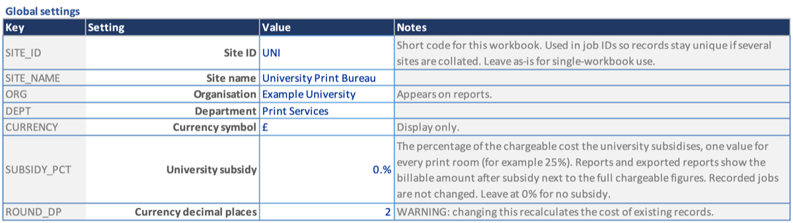
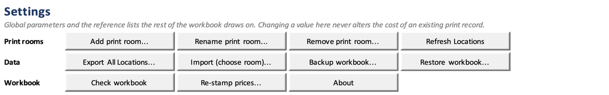

# Settings

Set your site's details, currency and rounding on the **Settings** sheet.

## Before you start

- Do this first, before you add printers, papers or print rooms. The Site ID
  goes into every ID the workbook issues from then on.

## Set up the global settings

1. Open the **Settings** sheet. The **Global settings** table starts at row 8.
2. In the **Value** column, fill in:
   - **Site ID**: a short code for this workbook, such as `MAIN`. It starts
     every Job ID, for example `MAIN-ART-00001`.
   - **Site name**, **Organisation** and **Department**: these appear on
     reports and exports.
   - **Currency symbol**: for display only. It does not convert anything.
   - **Currency decimal places**: usually 2.
3. Leave the rest at their defaults unless you need them (see the table below).

## Result

New IDs use your Site ID, and costs show in your currency.

## The other settings

| Setting | What it does | Page |
| --- | --- | --- |
| **University subsidy** | A percentage of the chargeable cost the university pays, such as 25%. Reports show the amount after subsidy beside the full figures. Recorded jobs are not changed. | [Filtering](Reports-Filtering) |
| **Export folder** | Where exports and reports are saved. Blank saves beside the workbook. The folder must already exist. | [Exporting a print room](Data-Export-Room) |
| **Report heading** | The heading at the top of an exported report. Blank gives "Print job report". | [Exporting a report](Reports-Export) |
| **Reduced view - hidden columns**, **Minimal view - extra hidden columns** | The columns each view hides, separated by semicolons | [Views and units](Jobs-Views-and-Units) |
| **Location column view**, **Hide cost detail columns**, **Hide multi-pass columns** | Set by the buttons on each print room sheet; no need to edit here | [Views and units](Jobs-Views-and-Units) |

Rows whose **Notes** start "Read-only" are filled in by the workbook: the
version, when it was built, and the last ID numbers issued. They are locked.

## The buttons

The buttons at the top of the sheet are in three rows:

- **Print rooms**: **Add print room...**, **Rename print room...**, **Remove
  print room...**, **Refresh Locations**. See [Print rooms](Setup-Print-Rooms).
- **Data**: export, import, backup and restore. See [Exporting a print
  room](Data-Export-Room), [Importing jobs](Data-Import) and [Backup and
  restore](Data-Backup-and-Restore).
- **Workbook**: **Check workbook**, **Re-stamp prices...** and **About**.

The tables to the right of the settings (paper types, standard sizes,
consumable types) are covered in [Lookup lists](Setup-Lookup-Lists).

Below the tables, **PrintJob on GitHub** opens the project's home page.

## Things to know

- Changing a setting never changes the cost of a job already recorded. The
  one exception is **Currency decimal places**, which recalculates every job.
- If you change the **Site ID** later, IDs already issued keep the old code.
  Only new ones use the new code.
- **Export folder** has no Browse button. Type the folder's full path.

> **Warning:** **Re-stamp prices...** applies today's prices to every job in
> every print room. Use it only when a price was entered wrongly. It cannot
> be undone, so run **Backup workbook...** first.

## Platform notes

> **Mac:** if the workbook is in OneDrive and **Export folder** is blank, the
> files may land in your OneDrive folder or in Documents rather than beside
> the workbook. See [Exporting a print room](Data-Export-Room).
>
> **Windows:** not yet checked.

## Related pages

- [Getting started](Getting-Started)
- [Print rooms](Setup-Print-Rooms)
- [Glossary](Glossary)

---

*Draft for v0.11.5, with Mac screenshots. Not yet verified on Windows.*
